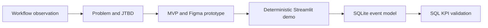

# AI Travel Itinerary Planner

A constraint-aware travel planning prototype that starts with places a traveller already chose and turns them into a feasible, explainable itinerary. The reconstructed portfolio implementation combines a Streamlit interface, deterministic geographic planning, explicit constraint checks, SQLite event modelling, and SQL product analytics. The strongest end-to-end demonstration preserves a fixed teamLab Planets booking and blocks confirmation while a schedule conflict remains.


## Problem

Independent travellers discover places across social, map, and messaging apps, then manually transfer, cluster, sequence, and validate them. The product job is: when I have found places I want to visit, organise them into a feasible itinerary so I do not have to coordinate the plan across multiple applications.

## Product Approach

The user chooses. The system organises, verifies, explains, and coordinates. V1 does not recommend a destination from scratch, buy tickets, process payments, or claim to be an autonomous production agent.

## End-to-End Workflow



The product flow is Social Content → Save to Trip → Trip Workspace → Geographic Clustering → Planning Setup → Verified Itinerary → Manual Adjustment → Conflict Detection → Re-optimization → Final Confirmation.

## Prototype

The two supplied screenshots in `assets/prototype/` are the authoritative historical visual assets. They cover the eight-screen interaction flow and are not redesigned or presented as newly generated evidence.

## Functional Demo

The demo loads ten Tokyo POIs across four days, groups places by area, assigns groups by daily load, sequences flexible visits with a nearest-neighbour heuristic, preserves fixed bookings, checks feasibility, and exposes confirmation only after validation. teamLab Planets, Tsukiji Outer Market, and Akihabara Electric Town are historically confirmed anchors. The other seven POIs are labelled reconstructed demo data.

## Planning Logic

- Haversine distance measures geographic proximity.
- Area labels provide explainable geographic clusters.
- Fixed bookings are allocated before flexible visits.
- Groups go to the least-loaded trip day.
- A nearest-neighbour heuristic sequences flexible POIs.
- Pace maps to a transparent daily visit-time limit.

This is a useful heuristic, not a globally optimal travelling-salesman solution.

## Constraint Validation

The planner checks opening windows, fixed dates and times, visit overlap, and daily workload. Warnings name the affected place and rule. The historical story included a Tsukiji closing-time issue and an Akihabara move; the tests reconstruct both rule types without claiming the full original dataset survived.

## Human-in-the-loop Design

System proposes → user changes → planner checks consequences → conflict is explained → planner re-optimises → user confirms. See `docs/product_design.md`.

## Product Data Model

`sql/schema.sql` models users, trips, saved places, bookings, itineraries, itinerary items, and events. `scripts/setup_demo_db.py` creates explicitly simulated demo events for analytics validation.

## Measurement Framework

Six core KPIs are Planning Conversion, Initial Plan Acceptance, Adjustment Rate, Conflict Rate, Confirmation Rate, and Time to Confirmed Plan. Re-optimization Rate, Average Saved POIs, and Modifications Before Confirmation are supporting diagnostics. Definitions are in `docs/metrics.md`.

## SQL Analytics

`sql/analytics.sql` contains ten practical analyses covering activity, planning starts, generated status, conversion, acceptance, adjustment, conflict and re-optimization, saved POIs, modifications, and time to confirmation. It uses grouping, conditional aggregation, CTEs, event ordering, and `julianday()` where they clarify the metric.

## Demo Validation

The test suite covers Haversine distance, opening-hour conflict detection, fixed-booking preservation, confirmation gating, and KPI SQL sanity. The historical final validation reported zero checks flagged; this repository treats that as historical evidence and independently tests the reconstructed rules.

## Repository Structure

```text
app.py                 Streamlit demo
src/                   planning, routing, constraints, and models
data/                  reconstructed Tokyo demo data
assets/prototype/      supplied historical Figma screenshots
sql/                   schema and ten product analyses
scripts/               simulated event database setup
tests/                 focused planner and analytics tests
docs/                  design and measurement notes
```

## How to Run

```bash
python3 -m venv .venv
source .venv/bin/activate
pip install -r requirements.txt
streamlit run app.py
python -m unittest discover -s tests
python scripts/setup_demo_db.py
```

## Limitations

This is a reconstructed portfolio implementation, not the literal historical source. It is deterministic, has no production users, and uses simulated analytics events. It does not claim globally optimal routing, live maps, live booking, mobile integration, or production LLM orchestration. Opening hours and travel-time assumptions are simplified.

## Future Work

Useful extensions would add verified opening-hour feeds, transit-time matrices, clearer manual move controls, and persistent trip editing while preserving explicit user control.
