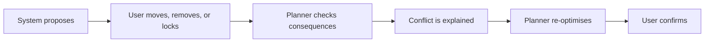

# Product design record

The historical prototype addressed the work between discovery and execution. Travellers already had places from Instagram, Xiaohongshu, Reddit, maps, messages, and friends. The unresolved work was transferring, deduplicating, grouping, sequencing, and validating those places.

The supplied Figma screenshots are preserved unchanged in `assets/prototype/`. They show the historical eight-screen flow: Social Content, Save Confirmation, Tokyo Trip, Planning Setup, Verified Itinerary, Adjust Plan, Conflict Warning, and Final Plan.

The central interaction remains human-in-the-loop:

The language-model concept was limited to interpreting saved content, preferences, and explanations. Coordinates, distance, grouping, routing, opening hours, reservations, and feasibility were deterministic responsibilities. This repository implements the deterministic side only.
